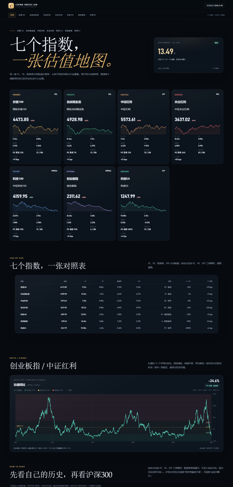

# CHINA INDEX LAB · 七个中国指数估值罗盘

一个以可视化为主的中国指数长期估值站点，覆盖 **价值100、自由现金流、中证红利、央企红利、科技100、创业板指、科创50** 七个指数，统一与 **沪深300** 对比。

指标包括：**PE-TTM、PB、股息率、风险溢价（ERP）**、历史分位、相对表现与月度季节性。



## 页面

- `index.html`：七个指数总览与横向对照
- `value100.html`：国证价值100（980081）
- `fcf.html`：国证自由现金流（980092）
- `dividend.html`：中证红利（000922）
- `soe-dividend.html`：中证央企红利（000825）
- `tech100.html`：中证科技100（931187）
- `chinext.html`：创业板指（399006）
- `star.html`：科创50（000688）

每页包含：价格与 52 周区间、估值温度、PE/PB/ERP 历史曲线、相对沪深300表现、当前股息率与历史分位、月度季节性、月度估值日志。图表默认 **“全部”**（从该指数数据起点开始），可切换 1 / 3 / 5 年；所有图表支持**滚轮缩放、拖拽平移、双击复位**。

总览页新增 **创业板指 / 中证红利（399006 / 000922）比值同比 + 分位区间**：最大时间跨度、滚轮缩放、拖拽平移、双击复位，虚线为历史均值；按 20% / 80% 分位标注**机会 / 适中 / 危险**区域，并显示当前百分位。比值同比 = 比值 / 252 个交易日前 − 1。

## 快速开始

```bash
cd china-index-compass
python -m venv .venv
.venv\Scripts\activate
pip install -r requirements.txt
python scripts/fetch_data.py
python scripts/build_site.py
python serve.py
# http://127.0.0.1:8765
```

也可以直接双击 `site/index.html`。

## 指标口径

| 指标 | 公式 / 口径 | 性质 |
| --- | --- | --- |
| PE-TTM | 指数点位 ÷ 组合 TTM 盈利 | 数据源现值 + 历史 |
| PB | 指数点位 ÷ 组合净资产 | 数据源现值 + 历史 |
| 股息率 | 近 12 个月现金分红 ÷ 点位 | 当前值 + 历史分位 |
| ERP | 1/PE − 中国 10 年期国债收益率 | 由 PE 与国债推导 |
| 综合分位 | PE 分位 + PB 分位 + (100 − ERP 分位)，三等权 | 统计 |
| 相对表现 | 指数 / 沪深300，价格指数归一 | 实际 |
| 季节性 | 日历月价格回报，完整月份 | 实际 |

- 综合分位**不含股息率**：股息率历史序列在七个指数之间不统一，单独展示当前值与分位，避免拼接不同口径。
- 价格指数不含股息；因此“相对表现”和“季节性”都是价格回报，不是全收益。
- 沪深300是宽基参照系，不是估值锚。

## 数据来源与边界

- **PE / PB / ROE 历史**：韭圈儿指数估值历史（Wind 口径）。
- **当前 PE / PB / 股息率 / 分位**：韭圈儿指数估值表，2026-11-18。
- **国证价值100 / 自由现金流的历史股息率**：由国证全收益指数与价格指数比推导 12 个月股息率。
- **中国 10 年期国债**：中国债券信息网 / AKShare，2026-11-18 为 **1.5892%**。
- 部分指数估值历史较短：
  - 价值100：2025-07 起
  - 自由现金流：2024-08 起
  - 科创50：2019-12 起
  - 科技100：2019-05 起
- 科创50 当前 PE 约 93x、PB 6.2x；估值历史从 2019-12 起可用，分位按这段历史计算。
- 中证红利、央企红利等指数的 PE/PB 为韭圈儿/Wind 口径，与中证指数官网的加权 PE 可能存在差异；站内所有 PE/PB 使用同一口径，便于横向比较，但不应与其他网站的数字直接拼接。

## 当前快照（2026-11-18）

| 指数 | 收盘 | PE-TTM | PB | 股息率 | ERP | 综合分位 | vs 沪深300 PE | 1Y 相对 |
| --- | ---: | ---: | ---: | ---: | ---: | ---: | ---: | ---: |
| 价值100 | 4473.85 | 9.22x | 0.85x | 5.15% | 9.26% | 23 · 低估 | -31.7% | +19.8pp |
| 自由现金流 | 4928.98 | 12.56x | 1.37x | 3.62% | 6.37% | 21 · 低估 | -6.9% | +9.4pp |
| 中证红利 | 5573.61 | 9.31x | 0.90x | 4.22% | 9.15% | 52 · 适中 | -31.0% | +13.4pp |
| 央企红利 | 3637.02 | 10.23x | 0.98x | 4.09% | 8.19% | 83 · 高估 | -24.2% | +20.4pp |
| 科技100 | 4159.95 | 22.87x | 2.92x | 1.58% | 2.78% | 19 · 深度低估 | +69.5% 溢价 | +5.5pp |
| 创业板指 | 2311.62 | 26.26x | 3.68x | 1.32% | 2.22% | 6 · 深度低估 | +94.7% 溢价 | -14.5pp |
| 科创50 | 1247.99 | 92.88x | 6.15x | 0.26% | -0.51% | 57 · 适中 | +588.5% 溢价 | +4.3pp |
| 沪深300 | 3983.77 | 13.49x | 1.33x | 3.11% | 5.82% | 39 · 低估 | — | — |

> `vs 沪深300 PE` 为负表示折价，正表示溢价；与页面中的 `折扣/溢价` 文案对应。

## 目录

```text
china-index-compass/
├─ .github/workflows/update-and-deploy.yml
├─ site/
│  ├─ index.html
│  ├─ value100.html / fcf.html
│  ├─ dividend.html / soe-dividend.html
│  ├─ tech100.html / chinext.html / star.html
│  ├─ styles.css
│  ├─ app.js
│  ├─ hub.js
│  ├─ data/
│  └─ assets/chart.umd.min.js
├─ scripts/
│  ├─ fetch_data.py
│  ├─ build_site.py
│  └─ indices.py
├─ data/raw/
├─ templates/page.html
├─ serve.py
└─ README.md
```

## 自动更新

工作流：[.github/workflows/update-and-deploy.yml](.github/workflows/update-and-deploy.yml)

```yaml
cron: "0 10 * * 1-5"
```

UTC 周一至周五 10:00 = **北京时间周一至周五 18:00**，在 A 股收盘后更新。

每次运行：

- 从韭圈儿拉取 8 个指数的 PE/PB/ROE 历史与当前估值；
- 从国证指数拉取价值100/自由现金流全收益序列；
- 从中国债券信息网拉取 10 年期国债；
- 重建 7 个页面、hub、JSON、CSV；
- 部署 `site/` 到 GitHub Pages。

## GitHub Pages

仓库建议名：`china-index-compass`。

```text
https://zeraray929418798.github.io/china-index-compass/
```

一次性设置：**Settings → Pages → Source = GitHub Actions**，然后手动跑一次 **Actions → Update China index data and deploy → Run workflow**。

## 边界

这是一个研究与教育工具，不构成任何证券、基金或投资策略的推荐。历史分位不代表未来回归；价格指数不含股息；部分指数历史较短；不同数据商的 PE/PB 口径可能不同。投资前请自行复核并咨询持牌顾问。
